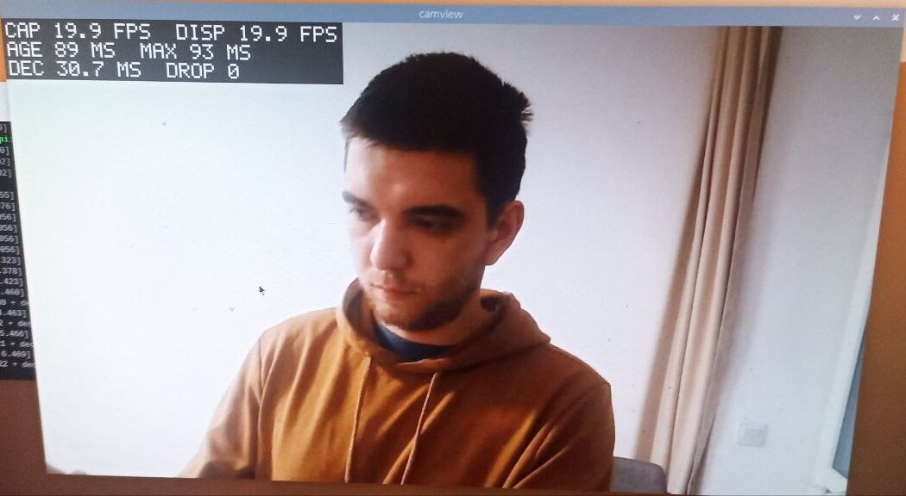

# camview

Low-latency live preview of a USB (UVC) camera on Linux. C++20, V4L2, libjpeg-turbo, SDL2.

Measured on a Raspberry Pi 2 as the worst case: 1280×720 at the camera's full 20 fps with ~90 ms frame age, 640×480 with ~65 ms.

Українська версія: [README.uk.md](README.uk.md)



## Implemented levels

| Level | What is done |
| --- | --- |
| 0 | Camera → window → quit with Esc or q. Resolution, pixel format and measured FPS in the log. Stable over a 16-minute run |
| 1 | `--device`, `--width`, `--height`, `--fps` with validation (invalid input → message and exit code 2). Measured FPS in the console and the overlay |
| 2 | Separate capture and render threads; only the newest frame is kept, older ones are dropped, so latency does not grow. Overlay with FPS, frame age and dropped frames |
| 3 | Closest camera mode is chosen automatically. Clear errors when the camera cannot be opened. "NO SIGNAL" and automatic reconnect when it disappears. Code split into `CameraSource`, `Frame`, `Renderer`, `App` |

## Dependencies

Ubuntu 22.04+, Debian 12+ or Raspberry Pi OS; GCC 11+ and CMake 3.22+ (tested with GCC 13 and 14):

```bash
sudo apt install build-essential cmake ninja-build pkg-config libsdl2-dev libturbojpeg0-dev libgtest-dev
```

GoogleTest is only needed for tests; without it, configure with `-DCAMVIEW_BUILD_TESTS=OFF`. The user must be in the `video` group to access the camera.

## Build

```bash
git clone https://github.com/KostetskyiPavlo/camview.git
cd camview
cmake --preset release && cmake --build --preset release && ctest --preset release
```

The binary is `build/release/camview`. Presets `debug`, `asan` and `tsan` build with warnings as errors and sanitizers.

## Run

The window opens on the display of the machine the program runs on: run it in a terminal of that machine's desktop, or see the SSH example below. Without a camera (for example in WSL) use `--test-pattern`.

```bash
./build/release/camview                                                  # /dev/video0, closest mode to 1280x720 @ 60 fps
./build/release/camview --device /dev/video0 --width 1280 --height 720 --fps 30
./build/release/camview --list-modes                                     # modes the camera offers
./build/release/camview --test-pattern                                   # synthetic source, no camera needed
./build/release/camview --extra-render-delay 200                         # slow display: frames drop, latency stays bounded
./build/release/camview --help                                           # all options
```

Width, height and frame rate are a request: the closest mode the camera offers is used, and the log shows what was requested, selected and actually set. Quit with Esc or q, by closing the window, or with Ctrl+C.

On a Raspberry Pi over SSH, point the program at the Pi's desktop session (or use `--no-display`):

```bash
XDG_RUNTIME_DIR=/run/user/1000 WAYLAND_DISPLAY=wayland-0 SDL_VIDEODRIVER=wayland ./build/release/camview
```

## Notes

**What I chose and why**

- **V4L2 directly instead of OpenCV.** It shows what happens with the frames: each frame carries the driver's timestamp, so the program can measure how old a frame is when it reaches the screen. It also gives the camera's list of modes and reports when the camera is unplugged.
- **MJPEG, decoded with libjpeg-turbo, shown with SDL2.** The decoder outputs YUV and SDL turns it into colours on the GPU, so the CPU only decodes. Uncompressed YUYV on this camera is limited to 640×480 and on the Pi 2 often arrived damaged, so MJPEG is the default.
- **Two threads and a mailbox for one frame, not a queue.** With a queue a slow display would show older and older frames. The mailbox keeps only the newest frame and the older one is dropped before decoding, so the delay stays bounded.
- **Frame rate before resolution** when the camera has no exact match. In my measurements the transfer took one frame interval, so more frames per second means fresher frames — what matters most for drone video.
- **No camera at start: error. Camera lost while running: reconnect.** At start the usual cause is a wrong `--device`; while running, a loose cable.

**Bottlenecks (measured on a Raspberry Pi 2)**

- **The camera and USB transfer:** about 50 ms at 20 fps, roughly three quarters of the total 65 ms at 640×480. The code cannot speed this up; a camera with a higher frame rate can.
- **MJPEG decoding on the CPU:** 12 ms at 640×480, 29 ms at 1280×720. Comparing with GStreamer I found that my colour conversion did a division for every pixel, and on 32-bit Raspberry Pi OS division is slow (the processor target has no division instruction). After removing it decoding became 43% faster and CPU usage matched GStreamer.
- **Damaged uncompressed frames under load:** they appeared when the memory was busy, not when the CPU was busy, so the likely cause is the USB controller sharing the memory bus with the CPU and GPU. MJPEG suffered much less.
- **CPU power saving:** with the default `ondemand` setting the CPU slows down between frames and decoding took up to 1.5× longer.

**What I would improve**

- Use the Pi's hardware JPEG decoder instead of the CPU.
- Measure the full delay "from lens to screen" by filming the screen together with a clock; the program measures only from the moment the frame reaches the computer.
- Switch to a smaller camera mode automatically when decoding cannot keep up.
- Full-screen output without a desktop, to remove one more layer between the frame and the screen.
- Automatic build and tests on every commit (CI).
