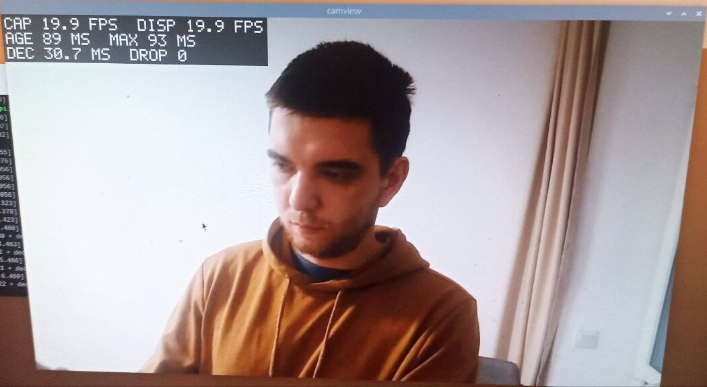

# camview

Перегляд відео з USB-камери (UVC) на Linux у реальному часі з мінімальною затримкою. C++20, V4L2, libjpeg-turbo, SDL2.

Виміряно на Raspberry Pi 2 як на найгіршому випадку: 1280×720 на повних 20 fps камери з віком кадру ~90 мс, 640×480 — ~65 мс.

English version: [README.md](README.md)



## Виконані рівні

| Рівень | Що зроблено |
| --- | --- |
| 0 | Камера → вікно → вихід по Esc або q. Роздільна здатність, формат пікселів і виміряний FPS у лозі. 16 хвилин роботи без помилок |
| 1 | `--device`, `--width`, `--height`, `--fps` з валідацією (неправильне значення → повідомлення й код виходу 2). Виміряний FPS у консолі й overlay |
| 2 | Окремі потоки захоплення й показу; зберігається лише найновіший кадр, старі відкидаються, тож затримка не росте. Overlay з FPS, віком кадру й кількістю відкинутих кадрів |
| 3 | Найближчий режим камери обирається автоматично. Зрозумілі помилки, якщо камера не відкривається. «NO SIGNAL» і автоматичне перепідключення, якщо камеру від'єднали або вона перестала надсилати кадри. Код розділено на `CameraSource`, `Frame`, `Renderer`, `App` |

## Залежності

Ubuntu 22.04+, Debian 12+ або Raspberry Pi OS; GCC 11+ і CMake 3.22+ (перевірено з GCC 13 і 14):

```bash
sudo apt install build-essential cmake ninja-build pkg-config libsdl2-dev libturbojpeg0-dev libgtest-dev
```

GoogleTest потрібен лише для тестів; без нього конфігуруйте з `-DCAMVIEW_BUILD_TESTS=OFF`. Для доступу до камери користувач має бути в групі `video`.

## Збірка

```bash
git clone https://github.com/KostetskyiPavlo/camview.git
cd camview
cmake --preset release && cmake --build --preset release && ctest --preset release
```

Бінарник — `build/release/camview`. Пресети `debug`, `asan` і `tsan` збирають з попередженнями як помилками й sanitizers.

## Запуск

Вікно відкривається на дисплеї машини, де запущено програму: запускайте в терміналі робочого столу цієї машини або див. приклад для SSH нижче. Без камери (наприклад, у WSL) — `--test-pattern`.

```bash
./build/release/camview                                                  # /dev/video0, найближчий режим до 1280x720 @ 60 fps
./build/release/camview --device /dev/video0 --width 1280 --height 720 --fps 30
./build/release/camview --list-modes                                     # режими, які пропонує камера
./build/release/camview --test-pattern                                   # синтетичне джерело, камера не потрібна
./build/release/camview --extra-render-delay 200                         # повільний показ: кадри відкидаються, затримка обмежена
./build/release/camview --help                                           # усі опції
```

Ширина, висота й частота кадрів — це запит: використовується найближчий режим камери, а лог показує, що запитано, що обрано й що реально встановлено. Вихід — Esc або q, закриття вікна чи Ctrl+C.

На Raspberry Pi через SSH вкажіть програмі графічну сесію самої Pi (або використайте `--no-display`):

```bash
XDG_RUNTIME_DIR=/run/user/1000 WAYLAND_DISPLAY=wayland-0 SDL_VIDEODRIVER=wayland ./build/release/camview
```

## Нотатки

**Що обрав і чому**

- **V4L2 напряму, а не OpenCV.** Так видно, що відбувається з кадрами: кожен кадр має таймстемп від драйвера, тож програма може виміряти, наскільки «старим» кадр доходить до екрана. Також V4L2 дає список режимів камери й повідомляє, коли камеру від'єднали.
- **MJPEG, декодування через libjpeg-turbo, показ через SDL2.** Декодер видає YUV, а перетворення в кольори робить GPU, тож CPU лише декодує. Нестиснений YUYV на цій камері обмежений 640×480, а на Pi 2 часто надходив пошкодженим, тому за замовчуванням — MJPEG.
- **Два потоки й скринька на один кадр, а не черга.** З чергою повільний показ відображав би дедалі старіші кадри. Скринька тримає лише найновіший кадр, а старий відкидається ще до декодування, тож затримка не росте.
- **Частота кадрів важливіша за роздільну здатність**, якщо в камери немає точного режиму. За моїми вимірами передача кадру займає один інтервал між кадрами, тож більше кадрів на секунду — свіжіші кадри, а це найважливіше для відео з дронів.
- **Камери немає при старті — помилка. Камера пропала під час роботи — перепідключення.** При старті зазвичай винен неправильний `--device`, під час роботи — поганий контакт кабелю. Камеру, яка лишається підключеною, але 3 секунди не надсилає кадрів, перевідкриваю так само.

**Вузькі місця (виміряно на Raspberry Pi 2)**

- **Камера й передача по USB:** близько 50 мс при 20 fps, тобто приблизно три чверті від загальних 65 мс на 640×480. Код це не прискорить; прискорить камера з вищою частотою кадрів.
- **Декодування MJPEG на CPU:** 12 мс на 640×480, 29 мс на 1280×720. Порівнюючи з GStreamer, я знайшов, що мій перерахунок кольору робив ділення для кожного пікселя, а на 32-бітній Raspberry Pi OS ділення повільне (цільовий процесор не має інструкції ділення). Після виправлення декодування стало на 43% швидшим, а навантаження на CPU — як у GStreamer.
- **Пошкоджені нестиснені кадри під навантаженням:** вони з'являлися, коли була зайнята пам'ять, а не процесор, тож найімовірніша причина — USB-контролер ділить шину пам'яті з CPU і GPU. MJPEG страждав значно менше.
- **Енергозбереження CPU:** зі стандартним налаштуванням `ondemand` процесор сповільнюється між кадрами, і декодування займало до 1.5 раза довше.

**Що б покращив**

- Використати апаратний JPEG-декодер Pi замість CPU.
- Виміряти повну затримку «від об'єктива до екрана», знявши на відео екран разом із годинником; програма міряє лише від моменту, коли кадр дійшов до комп'ютера.
- Автоматично переходити на менший режим камери, якщо декодування не встигає.
- Повноекранний вивід без робочого столу, щоб прибрати ще один шар між кадром і екраном.
- Для дрона: сервіс systemd з автоматичним перезапуском, стабільне ім'я пристрою через правило udev і очікування камери при старті замість виходу.
- Тести декодера на пошкоджених JPEG-файлах, довші прогони й серії від'єднань із виміряним часом перепідключення.
- Автоматичну збірку й тести на кожен коміт (CI).
